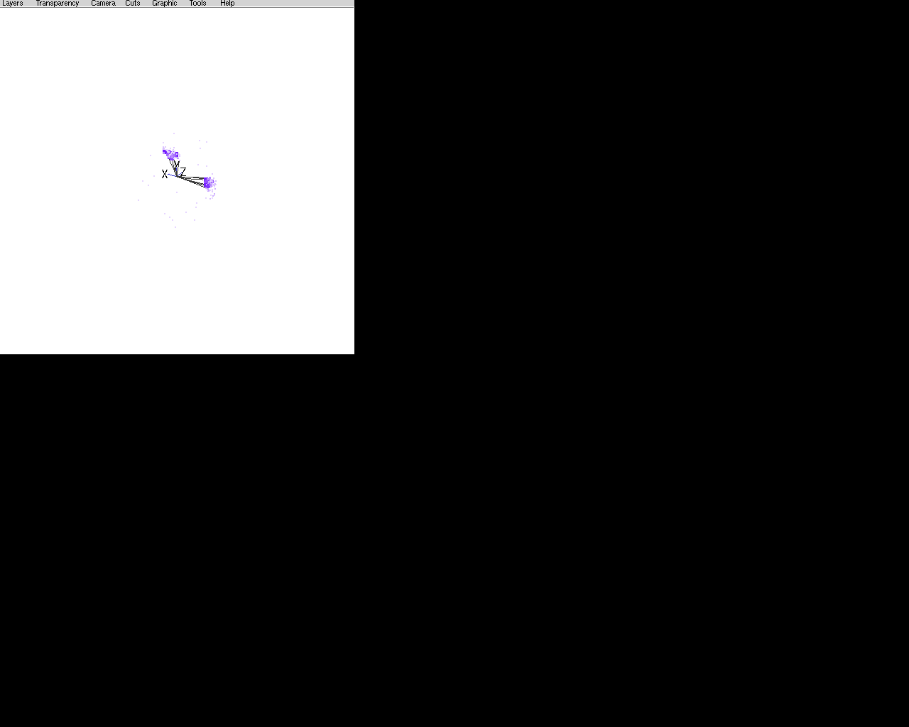

# CED backend

Registry name: `ced`. Built when `FCCVIS_ENABLE_CED` is on (default on
POSIX systems; no library dependency). It sends the scene to a running
[CED](https://github.com/iLCSoft/CED) display server (`glced`, the event
display of the linear-collider software) over CED's TCP protocol.

Start glced (it listens on port 7286; `CED_PORT=<n> glced` for another
port), then:

```{literalinclude} ../../examples/ced_session.fcv
:language: text
:start-after: "# [ced]"
:end-before: "# [ced]"
```

`host` and `port` default to `$CED_HOST` and `$CED_PORT` (else localhost,
7286).



## Mapping

CED shows one event at a time, so the backend draws one scene: the first
pane of the layout, or the first open scene without a layout.

| fccvis | CED |
|---|---|
| layer | a CED visibility layer (0, 1, ... in layer-name order; toggled with the number keys in glced), described by the layer name in glced's layer menu |
| point | `CED_Hit`: position, colour with transparency, size in pixels, shape (circle → point, square → box, cross → cross, other → star) |
| line | `CED_Line` segments between consecutive vertices, colour, width |
| surface | its outline as `CED_Line` segments (`edgeColor`, `edgeWidth`) |
| camera, environment | not transferred: glced has its own view controls |

Every object carries an id; double-clicking an object in glced sends the id
back and the backend reports a pick (scene, layer, entry, element index).
When glced closes the connection the backend stops. If no server listens,
the backend warns once and connects at the next update.

## Protocol

The backend implements CED's wire format itself (`CedProtocol.h`): per
element type a message `[int size][unsigned type]` followed by the items,
then a draw message; types are numbered in CED's registration order (lines
2, hits 3, layer descriptions 10, draw 10000). Values are sent in the
host's byte order, as CED does, so client and server must share it. No CED
code is linked (CED is GPLv3; this description was written from CED 1.10's
public client header for interoperability).

## Testing

`fccvis_ced_tests` checks the messages against a mock server in the test
(items, layers, descriptions, picks, the server closing). `ced::glced`
(labels `needs-ced`, `needs-x11`; runs when `glced` and `xdotool` are found)
starts the real glced 1.10 under a virtual X server, sends a hit,
double-clicks it with xdotool and expects the pick, then ends glced and
expects the backend to stop.
