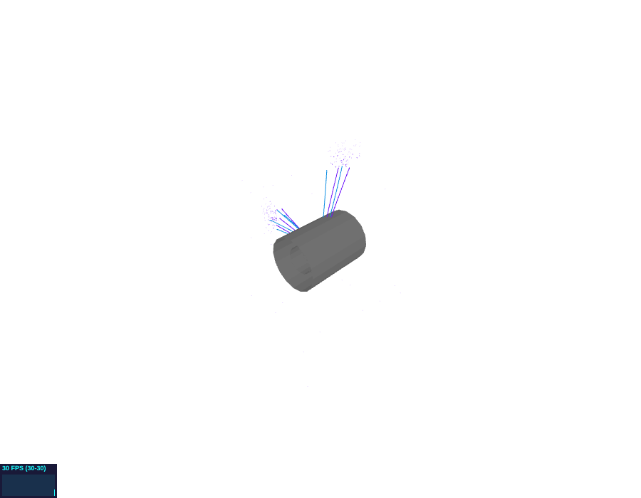

# Phoenix backend

Registry name: `phoenix`. Built when `FCCVIS_ENABLE_PHOENIX` is on (default on
POSIX systems; no library dependency). It exports the open scenes for
[Phoenix](https://github.com/HSF/phoenix), the web event display of the HEP
Software Foundation, and can serve the files over HTTP.

```{literalinclude} ../../examples/phoenix_session.fcv
:language: text
:start-after: "# [phoenix]"
:end-before: "# [phoenix]"
```

:::{admonition} Checked against Phoenix
:class: note
The output follows the Phoenix event-data format as documented in the Phoenix
sources (`guides/developers/event_data_format.md` and the loader
`phoenix-objects.ts`). It is also loaded into the Phoenix event display
(`phoenix-event-display` 4.2.3 from npm, the library the Phoenix web
application is built on) in headless Chromium by `tools/phoenix_verify`
(CTest `phoenix::viewer` when Node.js and the tool's packages are installed):
every event, every collection with its number of objects and every OBJ
object arrive, with no page errors, both from the files and through the
backend's HTTP host from another origin. The Phoenix web application itself
(phoenix-ng, with its menus) was not run.
:::



## Outputs

After every change that affects an open scene:

| File | Content |
|---|---|
| `events.json` | one Phoenix event per open scene (key = scene name) |
| `<scene>.obj`, `<scene>.mtl` | surface layers as Wavefront OBJ in millimetres, one object per layer and colour |

Mapping to the Phoenix event format:

| fccvis | Phoenix |
|---|---|
| point layer | `Hits` collection of `Point` objects: `pos` [x, y, z], `color` |
| point layer with several colours | one `Hits` collection per colour, named `<layer> #rrggbb` (Phoenix colours a collection by its first hit) |
| line layer | `Tracks` collection: `pos` (list of [x, y, z]), `color`, `linewidth` |
| metadata | extra keys of each object (`energy`, `charge`, `pT`, ...); Phoenix shows them and uses known ones for cuts |
| entry of the scene's first layer | `event number` |
| surface layer | OBJ object (load it as geometry in Phoenix) |

Filters apply exactly as in the other backends; styles contribute colours
and line widths (marker shapes and point sizes are not transferred).

## Serving

With `port=<n>` the backend serves its output directory on
`http://127.0.0.1:<n>/` (`bind=0.0.0.0` to accept other machines) with
`Access-Control-Allow-Origin: *` and `Cache-Control: no-store`. Phoenix loads
event data from a URL given as `?file=<url>&type=json`, and re-fetches it when
its event cycling wraps around with reloading enabled, so new events written
by fccvis appear on reload. Options and capabilities: see the
[backend reference](../reference/backends.md#phoenix).
