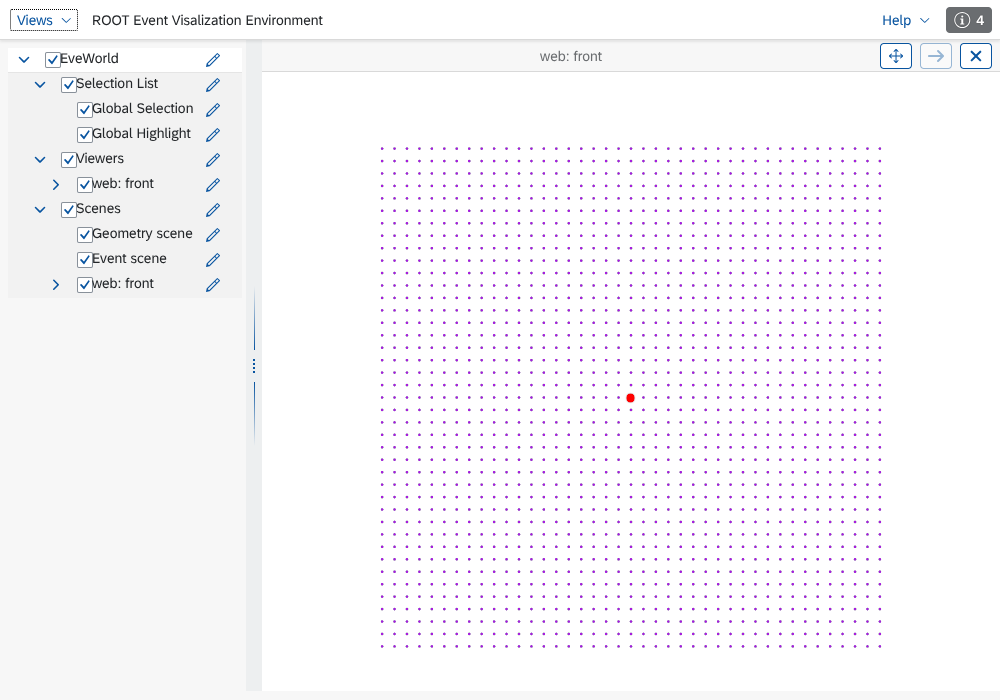

# ROOT REve backend (web)

Registry name: `reve`. Built when `FCCVIS_ENABLE_REVE` is on (default when
the ROOT backend is built and ROOT has the web viewer: `ROOT::ROOTEve`,
built with `webgui` and `root7`). REve, ROOT's web-based event display, is
served by ROOT's HTTP server: no X display is needed, the scenes are viewed
in a browser.

```{literalinclude} ../../examples/reve_session.fcv
:language: text
:start-after: "# [reve]"
:end-before: "# [reve]"
```

The backend logs the address of the page (`REve page for 'web':
http://localhost:<port>/win1/?key=...`); open it in a browser. Over SSH,
forward the port (`ssh -L <port>:localhost:<port> host`) and open the same
address locally; `bind=0.0.0.0` makes the server reachable from other
machines (anyone who has the address with its key can connect).



## Mapping

| fccvis | REve |
|---|---|
| open scene | `REveScene` shown in its own `REveViewer` (titled `<backend id>: <scene>`); the browser arranges the viewers, so split weights and tabs are not used |
| point layer | `REvePointSet` per resolved (colour, size, marker), with per-point picking |
| line | `REveLine` (colour, width, opacity) |
| surface | outline (`REveStraightLineSet` of the feature edges, `edgeColor`, `edgeWidth`); REve has no plain triangle-mesh element, so surfaces are not filled |
| camera along an axis | the matching orthographic camera; other directions a perspective camera. Zoom and pan stay in the browser |
| environment | `background` dark or light, `axes` |

## Interaction

| In the browser | In the session |
|---|---|
| click on a point, line or outline | pick event: scene, layer, entry, element index (shell: `picked in <backend>: ...`) |
| close the page | the backend stops (`stop_on_close=false` keeps it running for a later reload) |
| rotate, zoom | stays in the browser: REve does not report camera moves to the server |

## Options

| Option | Meaning |
|---|---|
| `port=<n>` | HTTP port (default: a free port in ROOT's `WebGui.HttpPortMin`..`Max` range) |
| `bind=<address>` | listen address (default 127.0.0.1) |
| `stop_on_close` | `true` (default) or `false` |
| `tolerance` | tessellation tolerance of curved surfaces |

REve itself prints progress messages (`EVEMNG ... streaming`) on standard
output. One REve page serves every `reve` instance of the process; each
instance has its own viewers. REve and the classic TEve backend can be used
in the same session: both run on the one ROOT thread.

## Testing

`fccvis_reve_tests` (labels `needs-root`, `needs-node`) loads the page in
headless Chromium with Playwright (`tests/backend/reve_drive.mjs`, packages
from `tools/phoenix_verify`): the viewer renders, a click in its centre is
reported as a pick of the point there, closing the page stops the backend.
`contract::reve` and `matrix::reve` run without a browser.
